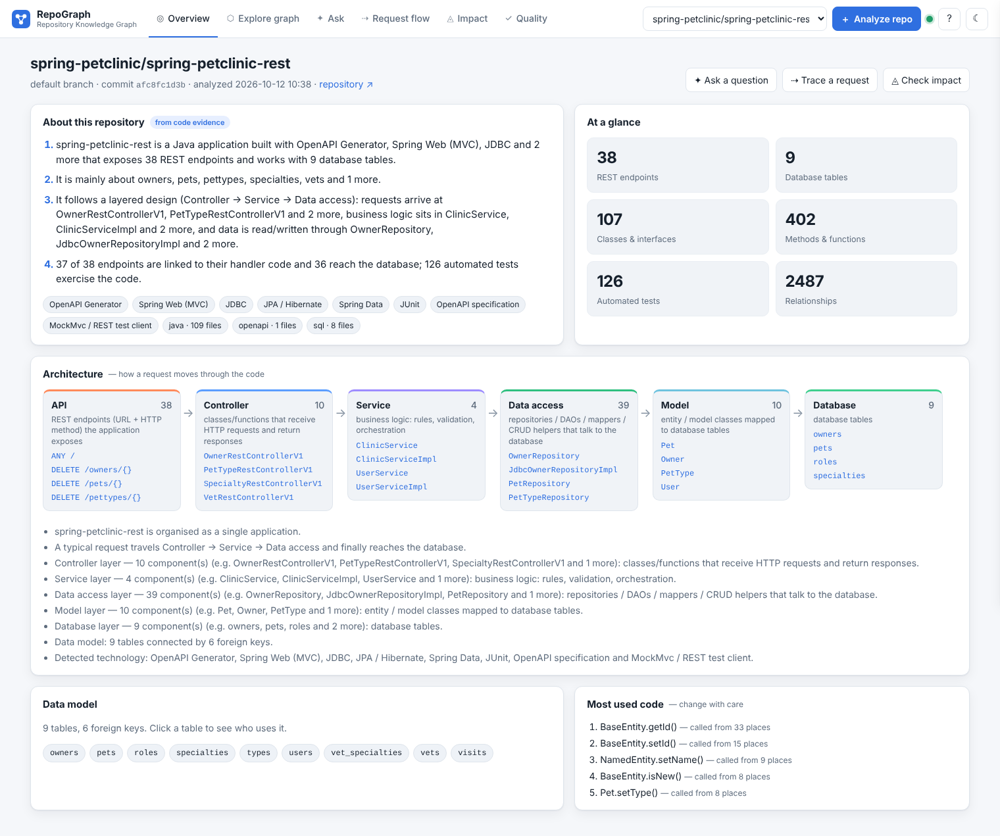

# Repository Knowledge Graph (RKG)

Evidence-backed knowledge graph for **Java · Python · SQL · REST/OpenAPI** repositories, with bounded graph
exploration and **graph-grounded natural-language questions** (Gemini optional, deterministic fallback built in).

> Paste a public GitHub URL → the system clones it (never executes it), parses the code, links
> `REST endpoint → handler → calls → SQL/ORM → table`, stores the graph (in-memory or Neo4j), and answers questions such as
> *"Which tables are touched by POST /owners/new?"* or *"What is impacted if I change the orders table?"* — citing file:line evidence for every fact.

```
 GitHub URL ─► acquire (safe shallow clone) ─► scan ─► analyzers ─► resolver ─► validator ─► store ─► queries ─► UI / API / NLP
                                                  │  Java (tree-sitter)       symbol index    ontology     in-memory   bounded views
                                                  │  Python (ast)             receiver types  evidence     or Neo4j    impact, paths
                                                  │  SQL (sqlparse+tokens)    imports/MRO     REJECTED     (parity)    API→DB
                                                  │  OpenAPI / MyBatis XML    HTTP matching   report
 Question ─► QueryPlan (Gemini structured output OR rule planner) ─► validate ─► allowlisted read-only query ─► facts ─► answer (+grounding check)
```

## What is extracted

| Area | Supported patterns | Edges |
|---|---|---|
| **Java** | classes, interfaces, enums, records, methods, constructors, fields, imports, generics, text blocks (tree-sitter, error tolerant) | `DEFINES` `IMPORTS` `EXTENDS` `IMPLEMENTS` `OVERRIDES` `CALLS` `INSTANTIATES` |
| **Java REST** | Spring `@RestController/@RequestMapping/@GetMapping…`, JAX-RS `@Path/@GET`, Feign clients, openapi-generator interface-only controllers (CANDIDATE) | `HANDLED_BY` `HTTP_CALLS` |
| **Java data** | JDBC/JdbcTemplate/JPA `createQuery`/`createNativeQuery`, `@Query`, MyBatis XML + annotations, Spring Data derived & inherited CRUD methods, `@Entity/@Table/@Column/@JoinColumn` | `EXECUTES` `READS` `WRITES` `MAPS_TO` `HAS_COLUMN` `FOREIGN_KEY` |
| **Python** | modules, classes, functions, methods, imports (absolute/relative), MRO, `self.x` attribute types, annotations | `CALLS` `INSTANTIATES` `EXTENDS` `OVERRIDES` `IMPORTS` |
| **Python REST** | Flask (`route`, blueprints + `url_prefix`, `register_blueprint`), FastAPI (`APIRouter(prefix)`, `include_router`), Django `urls.py` + `include()`, class-based views, DRF routers, Connexion `operationId` | `HANDLED_BY` |
| **Python data** | DB-API `execute`, SQLAlchemy `text()`, `select/insert/update/delete(Model)`, `session.add`, Flask-SQLAlchemy `Model.query`, Django ORM `objects.*`, SQLModel `table=True`, f-string SQL (CANDIDATE) | `EXECUTES` `READS` `WRITES` `MAPS_TO` `HAS_COLUMN` `FOREIGN_KEY` |
| **SQL** | `.sql` scripts: CREATE TABLE/VIEW/INDEX, ALTER (columns, FKs), DML with joins, sub-queries, CTEs (excluded), MERGE, aliases | `DEFINES` `READS` `WRITES` `HAS_COLUMN` `FOREIGN_KEY` |
| **OpenAPI** | Swagger 2 / OpenAPI 3 (JSON/YAML), `basePath`/`servers` prefix — contract only, never implies a handler | `DEFINES` |
| **Tests** | JUnit `@Test`… , pytest/unittest, MockMvc/RestAssured/TestClient requests | `TESTS` |
| **Cross-language** | RestTemplate/WebClient/Feign/requests/httpx calls matched to endpoints of another language in the repo | `CROSS_LANGUAGE_MAP` |

Every edge has `status` (**VERIFIED** / **CANDIDATE**), `source_kind` (mechanism), `evidence`, `file`, `line`, `reason`.
Edges that violate the ontology are **REJECTED** and only shown in diagnostics.

## Quick start (Windows PowerShell)

```powershell
cd repo-knowledge-graph
py -3.11 -m venv .venv
.\.venv\Scripts\Activate.ps1
python -m pip install --upgrade pip
python -m pip install -r requirements.txt
copy .env.example .env          # GRAPH_BACKEND=in_memory works without any database
python -m pytest -q              # 102 passed, 2 skipped (Neo4j tests need a running Neo4j)
python scripts\evaluate.py       # precision / recall on the labelled fixture
python -m uvicorn backend.app:app --reload
```
Open **http://127.0.0.1:8000** (UI) and **http://127.0.0.1:8000/docs** (Swagger UI of the API).
Linux/macOS: `python3 -m venv .venv && source .venv/bin/activate` and the same commands.

### With Neo4j
```bash
docker compose up -d neo4j        # browser at http://localhost:7474 (neo4j / change-me-please)
# .env: GRAPH_BACKEND=neo4j, NEO4J_PASSWORD=change-me-please
NEO4J_TEST_URI=bolt://localhost:7687 NEO4J_TEST_PASSWORD=change-me-please python -m pytest tests/test_store_parity.py
```
Whole stack in Docker: `docker compose up --build` → http://localhost:8000.

### With Gemini (free tier works) — natural language → Cypher → Neo4j
1. Key from https://aistudio.google.com/apikey → `.env`: `GEMINI_API_KEY=...`, `GRAPH_BACKEND=neo4j`, `NLP_MODE=hybrid`.
2. Ask anything in the UI. Lookup-style questions ("who calls X", "columns of table Y", "how many classes in package Z",
   "which endpoints are POST") are translated by Gemini into Cypher, which then passes the safety validator
   (`backend/nlp/cypher.py`): single read-only statement; CREATE/MERGE/SET/DELETE/CALL/LOAD CSV/apoc/UNION rejected;
   labels, relationship types, properties and functions allow-listed; `{graph_id: $gid}` scoping mandatory;
   variable-length paths bounded to `*..6`; LIMIT ≤ 200. It runs in a READ-mode Neo4j transaction with a 10 s timeout.
   A rejected query is sent back to Gemini once with the reason (self-repair); if it still fails or returns no rows,
   the reviewed traversal answers instead.
3. Impact analysis, API → database, test coverage and path questions always use the reviewed bounded traversals
   (weighted, direction-aware), and their equivalent Cypher is shown with the answer.
4. Every answer shows its Cypher, whether it was Gemini-generated and executed or a reviewed template, plus the
   grounded explanation. Gemini errors or quota limits (HTTP 429) trigger a 60 s circuit breaker and deterministic fallback.
5. Without Neo4j (in-memory backend) Gemini is used as a QueryPlan planner and answers come from the reviewed traversals.

### CLI
```bash
python scripts/cli.py analyze https://github.com/spring-projects/spring-petclinic
python scripts/cli.py list
python scripts/cli.py ask <graph_id> "Which tables are touched by POST /owners/new?"
```

## API

| Method | Path | Purpose |
|---|---|---|
| GET | `/api/health` | backend, NLP mode, auth |
| POST | `/api/analyze` `{repo_url, ref?, force?}` | start background analysis → `job_id` (cached per commit) |
| GET | `/api/jobs/{job_id}` | progress / `graph_id` / error |
| GET | `/api/graphs` | analyzed repositories |
| GET | `/api/graph/{gid}/summary` · `/export` · `/schema` · `/diagnostics` | report, full export, vocabulary, quality |
| GET | `/api/graph/{gid}/search?q=` | ranked entity search (exact qualified > name > substring) |
| GET | `/api/graph/{gid}/view?mode=architecture\|ecosystem\|hops\|cross-language` | bounded projections (`max_nodes`, `hops` ≤ 3) |
| GET | `/api/graph/{gid}/node?entity_id=` | entity + grouped relationships with evidence |
| GET | `/api/graph/{gid}/query/{name}` | `apis_and_handlers`, `api_to_database_path`, `sql_and_tables`, `tables_and_columns`, `call_graph`, `classes_and_methods`, `inheritance`, `tests_and_targets`, `dependencies_of`, `impact_of`, `cross_language` |
| GET | `/api/graph/{gid}/impact?root_id=` · `/path?from_id=&to_id=` | impact analysis (raw), shortest path |
| GET | `/api/graph/{gid}/profile` | 4-line plain-English summary + architecture (layers, frameworks, data model, central components) |
| GET | `/api/graph/{gid}/flow?api_id=` | request flow of one endpoint: lanes (Client → API → Controller → Service → Data access → Model → SQL → Database) + numbered evidence steps |
| GET | `/api/graph/{gid}/impact-report?root_id=&depth=` | risk level, blast radius 0–100, scored items, tests to run, untested APIs, heuristic "potential" effects, recommendations, model description |
| GET | `/api/graph/{gid}/edge?edge_id=` | one relationship with evidence, file, line and code snippet |
| POST | `/api/graph/{gid}/ask` `{question, context_entity_id?}` | graph-grounded answer: `status`, `answer`, `facts`, `paths`, `graph`, `cypher`, `query_plan`, `planner` |
| POST | `/api/graph/{gid}/ask/feedback` | helpful / not helpful (evaluation data) |

Answer `status`: `ANSWERED`, `INSUFFICIENT_EVIDENCE`, `NOT_FOUND`, `CLARIFY` (ambiguous → candidates), `UNSUPPORTED`.
Every answer carries `answer_nl` (plain English), `answer_dev` (names, files, lines, link status), `cypher`,
`breakdown` (intent → entity resolution → query choice → execution → evidence check) and `facts`.
Intents: `LOCATE_SYMBOL, LIST_METHODS, CALLERS, CALLEES, API_HANDLER, API_TO_DATA, SQL_TABLES, SCHEMA, TABLE_USAGE,
DEPENDENCIES, IMPACT, TEST_COVERAGE, PATH, LIST_APIS, LIST_TABLES, SUMMARY, COUNT, LIST_TYPE, FLOW, EXPLAIN, UNUSED,
HOTSPOTS, UNTESTED`. Names are fuzzy-matched (≥ 0.8) with a visible "interpreted as" note.

## Measured results (12 Oct 2026) — full report in [docs/EVALUATION.md](docs/EVALUATION.md)

| Check | Result |
|---|---|
| Labelled fixture, 10 relationship types | P = R = F1 = **1.00**, 8/8 APIs, 0 forbidden edges |
| Real repos, 119 hand-checked random edges (petclinic-rest, spring-boot-realworld, django-realworld) | **95.8 %** → 100 % after fixing mock-stub TESTS edges; fresh 24/24 re-check |
| Endpoint → handler coverage (5 repos) | 100 % of implemented endpoints (only spec-only `/oops` and Django's library `/admin` have no handler — correctly) |
| NL questions dev / held-out / frozen blind | 50/50 · 26/26 (first blind run 22/26) · 20/20 (official first run 19/20) |
| Speed | petclinic-rest 0.6 s, mall-swarm (638 files, 32 k edges) 3.8 s, commons-lang 6.2 s (local clone) |



## Project layout
```
backend/
  app.py                 FastAPI app (security middleware, rate limits, endpoints, static UI)
  config.py              all settings from environment / .env
  kg/model.py            canonical entities, relationships, ontology (allowed endpoints), IDs
  kg/acquire.py          safe clone: https only, host allowlist, no hooks/symlinks/prompts, timeout, size cap
  kg/scanner.py          exclusions, .gitignore, symlink & path-traversal guards, size limits
  kg/pipeline.py         orchestration, validator, quality report
  analyzers/             java_analyzer.py, python_analyzer.py, sql_analyzer.py, spec_analyzers.py, common.py
  graph/store.py         store interface + in-memory backend (gzip JSON persistence)
  graph/neo4j_store.py   Neo4j backend (parameterised templates, allowlisted labels/types, read-only tx)
  graph/queries.py       bounded projections, impact (0-1 BFS), API→DB, paths, named queries
  graph/insights.py      repo profile (4-line summary, architecture layers), request flow, impact risk report
  nlp/plan.py            QueryPlan schema + deterministic rule planner
  nlp/gemini.py          Gemini structured output + grounding check + circuit breaker
  nlp/cypher.py          NL → Cypher prompt (schema + examples), safety validator/rewriter, reviewed template Cypher
  nlp/engine.py          entity resolution (CLARIFY on ambiguity), intent handlers, answer packaging
  api/jobs.py            background analysis jobs, de-duplication, commit cache
frontend/                index.html, app.js, styles.css, vendor/ (Cytoscape + dagre + fCoSE, MIT, served locally)
tests/                   pytest suite + labelled fixture + ground truth
scripts/evaluate.py      precision/recall/F1 per relationship type
scripts/eval_nlp.py      NL question accuracy (dev / held-out / frozen blind sets)
scripts/sample_edges.py  reproducible random edge sample for manual precision review
docs/                    USER_MANUAL.md, EVALUATION.md, GUIDE.md, screenshots/, eval/ (reviewed samples)
scripts/cli.py           command line
```

## Security
Repository content is untrusted data: nothing is executed; clones are shallow, hook-free, symlink-free, time- and
size-limited and deleted after analysis; only `https://` URLs on `ALLOWED_GIT_HOSTS`; refs validated; XML parsed with
defusedxml; YAML with `safe_load`; graph IDs validated; all Neo4j queries parameterised with allowlisted labels;
LLM-written Cypher only runs after the allowlist validator in a READ transaction with a 10 s timeout; optional `API_KEY` header auth; per-IP rate limits; security headers; secrets only in `.env`.

## Known limitations (state these honestly in reviews)
* Static analysis: reflection, dependency-injection by name, dynamic dispatch beyond declared types, runtime route
  registration and generated code that is not committed are not followed (generated-API controllers are CANDIDATE).
* Python call resolution needs a resolvable receiver (self, imports, constructor assignment, annotations); untyped
  parameters are counted as unresolved.
* SQL extraction is conservative token analysis, not a full dialect parser; dynamic SQL is CANDIDATE.
* "Impact" means *connected under static dependency rules* — a review aid, not proof that something breaks.
* The in-memory backend keeps graphs in `DATA_DIR` (gzip JSON); multi-user/multi-instance deployment should use Neo4j.
* Neo4j parity test must be run on a machine with Neo4j (CI workflow does this automatically).
