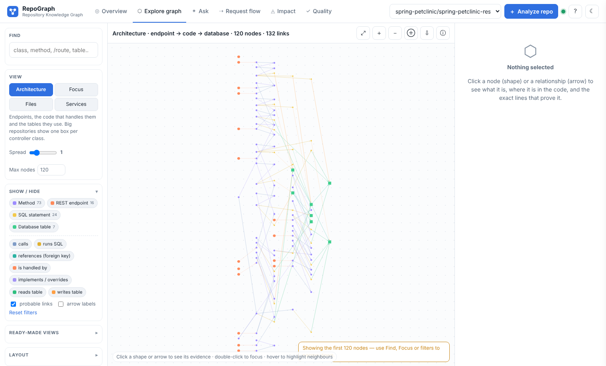
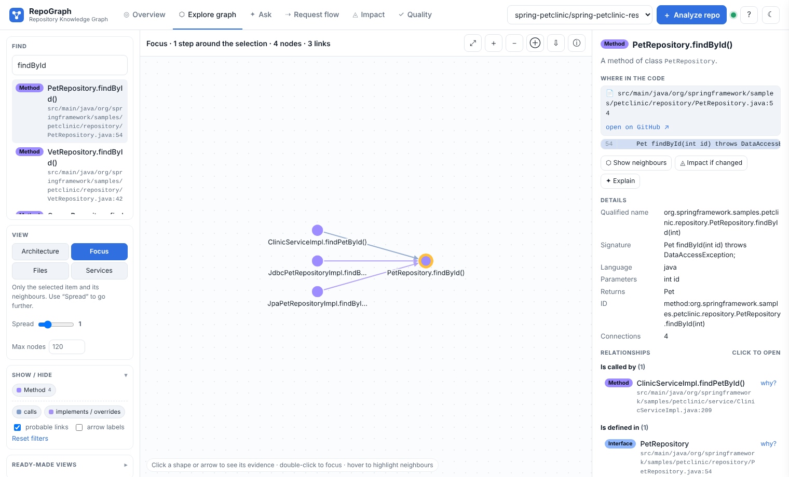
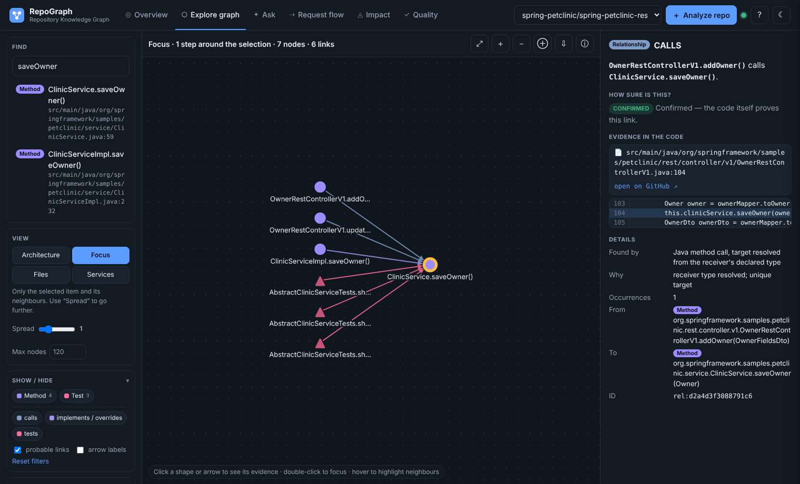
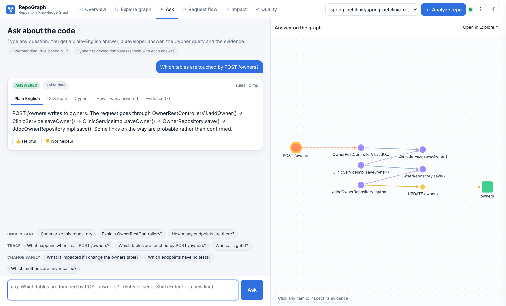
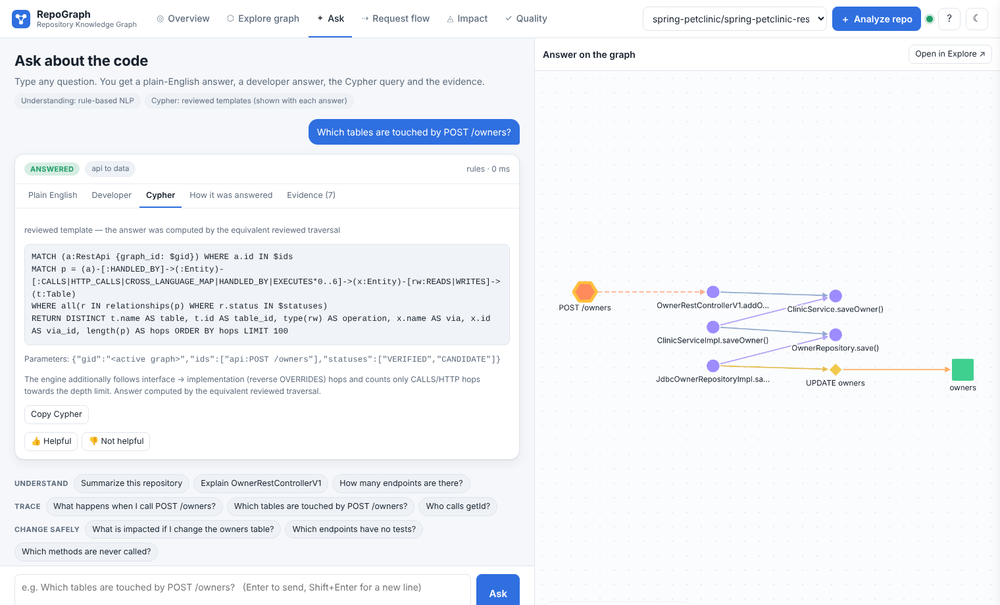
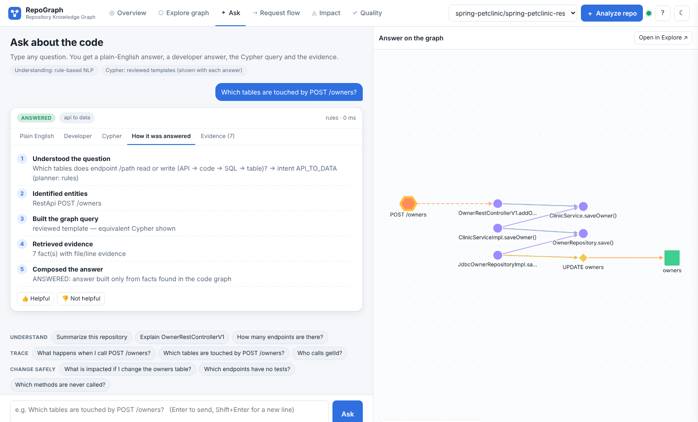
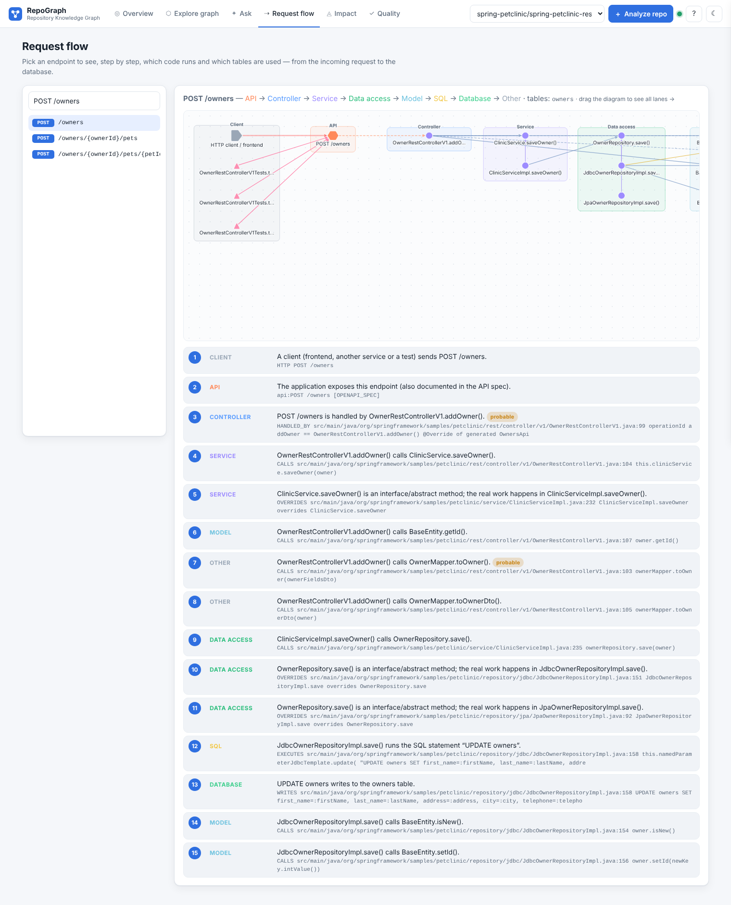
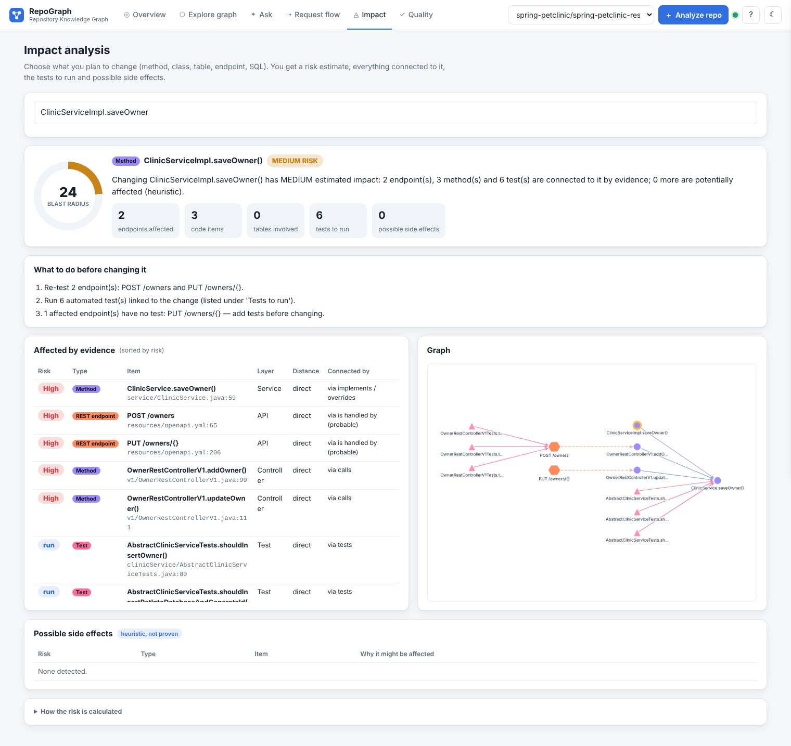
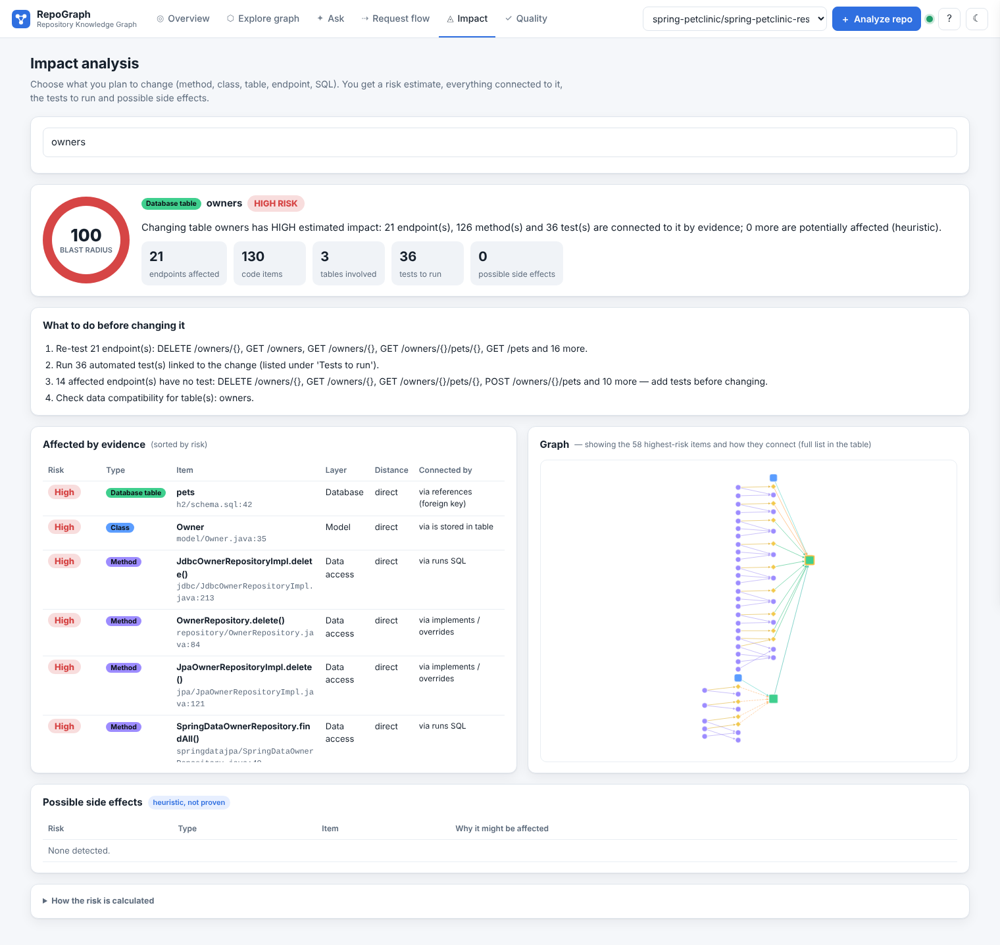
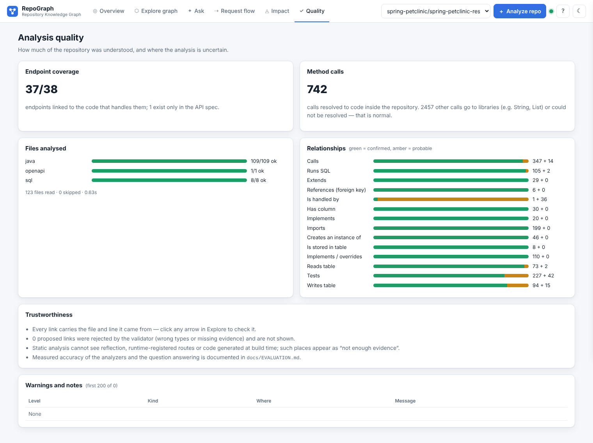

# RepoGraph — User Manual (simple English)

RepoGraph reads a code repository (Java, Python, SQL, REST/OpenAPI) and draws a **map of the code**: which endpoint
calls which method, which method runs which SQL, which table it touches, which test checks it. Every line on the
map has **proof**: the file and line number where the link was found. Nothing is guessed silently.

Use it when you join a new project, before you change something, or when you need to explain the code to someone.

---

## 1. The top bar

| Item | What it does |
|---|---|
| **RepoGraph** logo | Back to the Overview page |
| **Overview** | A 4-line summary of the repo, its architecture and its data model |
| **Explore graph** | The interactive map. Search, click, and see the evidence |
| **Ask** | Ask a question in plain English and get an answer, the query and the proof |
| **Request flow** | Pick an endpoint and see, step by step, the code it runs down to the database |
| **Impact** | Pick what you want to change and see what could break, plus the tests to run |
| **Quality** | How much of the repo was understood and what was skipped |
| Repo drop-down | Switch between analyzed repositories |
| **＋ Analyze repo** | Analyze a new GitHub/GitLab/Bitbucket link |
| Green dot | The server is OK (hover for details: graph database, NLP mode) |
| **?** | Help panel with the colour legend and tips |
| **☾** | Light/dark theme |

## 2. Analyze a repository (do this first)

1. Click **＋ Analyze repo**.
2. Paste a public link, e.g. `https://github.com/spring-petclinic/spring-petclinic-rest`.
3. Optional: **Branch or tag**. Leave it empty for the default branch. Tick *Re-analyze* only to force a fresh run of a commit that was already analyzed.
4. Click **Start analysis**. A progress bar shows cloning → parsing → building the graph. Small repos take seconds; a large
   one (600+ files) takes about a minute including the download.
5. When it finishes, the Overview page opens. The repo stays in the drop-down for next time.

The code is **only read, never run**.

## 3. Overview: understand the repo in one minute

* **About this repository**: 4 plain sentences: what it is, what it is about, how it is built, how well it is
  connected (endpoints linked to code, tests). The chips list the detected frameworks and languages.
* **At a glance**: counts of endpoints, tables, classes, methods, tests and relationships.
* **Architecture**: the layers a request passes through (API → Controller → Service → Data access → Model →
  Database), with the main classes in each. Click any name to open it in the map. The bullet list explains each layer
  in words.
* **Data model**: all tables. Click one to see who uses it.
* **Most used code**: the methods called from the most places. Change these with care.
* Buttons on the top right: **Ask a question**, **Trace a request**, **Check impact**.

## 4. Explore graph: the map

**Left panel**
* **Find**: type part of a name (`saveOwner`, `owners`, `POST /owners`). Click a result to focus on it.
* **View**:
  * *Architecture*: the whole system, endpoint → code → table. Big repos switch to a module summary automatically.
  * *Focus*: only the selected item and its neighbours. **Spread** = how many steps out to go (1–3).
  * *Files*: which file uses which file.
  * *Services*: microservices and the HTTP calls between them.
* **Show / Hide**: tick node types and link types on or off. **probable links** hides or shows the uncertain links.
  **arrow labels** writes the relationship name on every arrow.
* **Ready-made views**: common pictures in one click: endpoints and handlers, endpoint → database paths, SQL and
  tables, tables/columns/foreign keys, call graph, classes and methods, inheritance, tests and what they test.

**Canvas**: click a shape or an arrow to see its proof; double-click to focus on it; hover to highlight neighbours.
Toolbar buttons: fit to screen, zoom in/out, show neighbours of the selection, download picture, legend. The
**Layout** box in the left panel switches between *left → right (layered)* and *clusters*.

### 4.1 Click a shape: node evidence

The right panel shows:
* **Where in the code**: the file path and line number, a link **open on GitHub** (to the exact line at the
  analyzed commit), and the code lines themselves with the important line highlighted.
* **Buttons**: *Show neighbours*, *Impact if changed*, *Explain* (asks the Ask page about it).
* **Details**: qualified name, signature, parameters, return type, annotations, language, ID.
* **Relationships**: grouped in words ("Is called by", "Calls", "Runs SQL", "Is defined in"…). Each one shows the
  other item with its file:line. Click it to jump there, or click **why?** to see that relationship's proof.

### 4.2 Click an arrow: relationship evidence

* A sentence: "*OwnerRestControllerV1.addOwner() calls ClinicService.saveOwner()*".
* **How sure is this?**
  * **CONFIRMED** (solid line): the code proves it, e.g. the receiver's type was resolved.
  * **PROBABLE** (dashed line): very likely but not proven, e.g. two overloads match, or the link follows a framework
    convention. The reason is always written.
* **Evidence in the code**: file, line, GitHub link and the code lines (the matching line highlighted).
* **Details**: *Found by* (which rule found it), *Why*, *Occurrences*, *From*, *To*.

### 4.3 Shapes and colours

| Shape / colour | Meaning |
|---|---|
| Orange hexagon | REST endpoint (`GET /owners`) |
| Blue square | Class / interface |
| Purple circle | Method / function |
| Yellow diamond | SQL statement |
| Green square | Database table |
| Pink triangle | Test |
| Solid arrow | Confirmed link |
| Dashed arrow | Probable link (reason given) |

The full legend is in **?** (top bar).

## 5. Ask: questions in plain English

Type a question and press Enter. Examples (also shown as clickable chips):

| Goal | Example question |
|---|---|
| Understand | *Summarize this repository* · *Explain OwnerRestControllerV1* · *How many endpoints are there?* · *List all tables* |
| Trace | *What happens when I call POST /owners?* · *Which tables are touched by POST /owners?* · *Who calls getId?* · *What does saveOwner call?* · *Path from OwnerRestControllerV1 to owners* |
| Change safely | *What is impacted if I change the owners table?* · *Which endpoints have no tests?* · *Which tests cover saveOwner?* · *Which methods are never called?* · *Most used methods* |
| Data | *Which code writes to the visits table?* · *Columns of owners* · *Which SQL reads pets?* |

Each answer has 5 tabs:

| Tab | For whom | What it shows |
|---|---|---|
| **Plain English** | anyone | A short answer in normal words |
| **Developer** | developers | Exact names, files and line numbers, status of every link |
| **Cypher** | Neo4j users | The graph query that produced the answer (copy it into Neo4j Desktop) |
| **How it was answered** | reviewers | The breakdown: 1 understood intent → 2 found the items → 3 chose the query → 4 ran it → 5 checked the evidence |
| **Evidence (n)** | reviewers | Every relationship used, with file:line. Click to open it |

 

The right side draws the answer on the graph. **Open in Explore** continues from there.

**Status badge on each answer**
* **ANSWERED**: found in the graph.
* **CHOOSE ONE**: the name matched several different things; click the one you mean.
* **NOT FOUND**: the name does not exist; close matches are suggested ("did you mean…").
* **NOT ENOUGH EVIDENCE**: the items exist but the graph has no proven link for what you asked.
* **OUT OF SCOPE**: the question is outside what the graph knows (e.g. runtime performance, who wrote the code).

**With or without Gemini**: without a key, questions are understood by built-in rules and answered with reviewed
queries; this works offline. With `GEMINI_API_KEY` in `.env`, Gemini also understands free-form questions and can write
Cypher; that Cypher is checked by a safety validator (read-only, limited) before it runs. Impact, flow and path
questions always use the reviewed queries.

👍 / 👎 under an answer is saved as feedback for improving the rules.

## 6. Request flow: from the client to the database

1. Type in the filter (e.g. `POST /owners`) and click an endpoint.
2. The diagram shows **lanes**: Client → API → Controller → Service → Data access → Model → SQL → Database → Other.
   Drag the diagram sideways to see all lanes.
3. Below it, the **numbered steps** in plain English, each with the proof (rule, file:line, code). Steps marked
   **probable** are not 100 % proven.
4. Click a step to open its evidence in the side panel.

Use it to answer "what runs when this endpoint is called?" before debugging or changing an endpoint.

## 7. Impact: what could break if I change this?

1. Type what you plan to change: a method, class, table, endpoint or SQL. Pick it from the list.
2. You get:
   * **Blast radius (0–100)** and a **risk level** (High / Medium / Low).
   * Counts: endpoints affected, code items, tables, tests to run, possible side effects.
   * **What to do before changing it**: endpoints to re-test, tests to run, endpoints with no test, tables to check.
   * **Affected by evidence**: every affected item with its risk, layer, distance ("direct" or "n links") and the
     relationship that connects it. Click a row for the proof.
   * **Graph**: the item you change on the right and everything that depends on it to the left. Big results show the
     ~45 highest-risk items (the table always has all of them).
   * **Possible side effects** (*heuristic, not proven*): e.g. other code that reads the same table, or methods with the
     same name. Treat these as "worth a look", not facts.
   * **How the risk is calculated**: the formula, open for anyone to check.

**The risk formula**: score = type weight × distance decay × certainty (probable links count 0.6).
High ≥ 0.6, Medium ≥ 0.3, else Low. Tests are listed as "run", not as risk.

## 8. Quality: can I trust this map?

* Files per language: how many were parsed OK.
* Calls resolved vs. unresolved, and how many links are probable.
* **Diagnostics**: what could not be understood and why (e.g. "method not found in the repository type hierarchy").
  Calls to outside libraries are not listed; they are expected.

If a whole language shows many failures, tell the maintainer with the repo link.

## 9. Known blind spots (the map does not show these yet)

* Calls made through reflection, Spring AOP aspects, event listeners, message queues (Kafka/RabbitMQ), scheduled jobs.
* SQL built from string pieces spread across several methods.
* Front-end code (JavaScript/TypeScript); the flow starts at the REST endpoint.
* Which overload is called when two overloads have the same number of arguments. Both are shown as *probable*.

Details and the measured accuracy are in [EVALUATION.md](EVALUATION.md).

## 10. Common problems

| Problem | Fix |
|---|---|
| "Host is not in ALLOWED_GIT_HOSTS" | Only GitHub, GitLab and Bitbucket links are accepted. Use the https link of the repo. |
| Analysis fails on a private repo | Only public repos are supported. |
| The map looks crowded | Use **Focus** with Spread 1, untick types in Show/Hide, or untick *probable links*. |
| An answer says NOT FOUND | Check the spelling; use the "did you mean" buttons; use the exact class or method name. |
| Gemini answers stop working | The free key has a per-minute limit; the rule-based answers keep working, so try again after a minute. |
| Status dot is red | The server or the graph database is down; restart the server. |

## 11. Supported code

| Language | What is understood |
|---|---|
| Java | Spring MVC/Boot, JAX-RS, Feign clients, Spring Data repositories, JPA entities and cascades, JDBC/JdbcTemplate, MyBatis (XML and annotations), JUnit tests incl. MockMvc/RestAssured-style HTTP calls (calls that only stub mocks are ignored) |
| Python | Flask, FastAPI, Django/DRF (urls + views + ORM models), Connexion, SQLAlchemy / Flask-SQLAlchemy models, Alembic migrations, raw SQL (DB-API, `text()`, pandas), aiosql/PugSQL named queries, pytest/unittest tests, HTTP client calls (`requests.get(...)` style) |
| SQL | CREATE TABLE (columns, keys, foreign keys), SELECT/INSERT/UPDATE/DELETE inside code or `.sql` files |
| REST / OpenAPI | OpenAPI 2/3 YAML/JSON operations, linked to handlers only through documented conventions (operationId generators, Connexion) |
